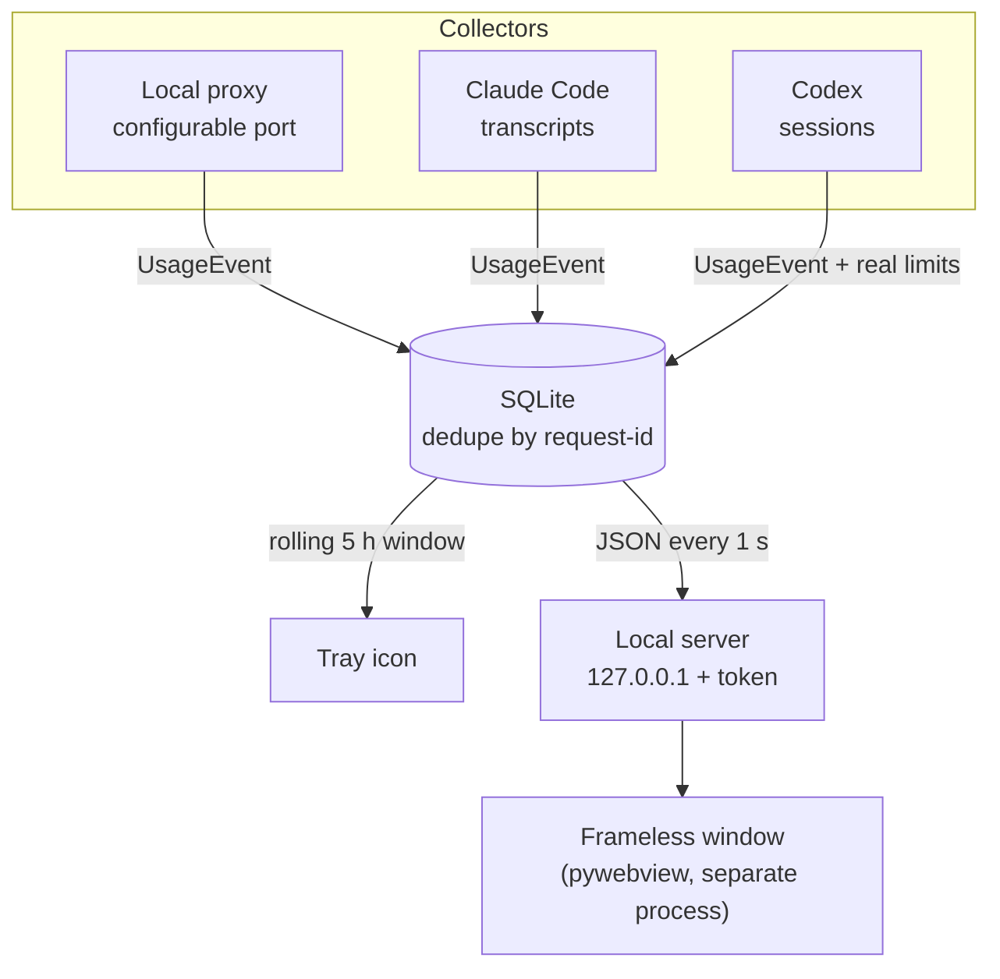

# TokenMeter

An LLM token meter that lives in the Windows system tray. The tray icon shows the
percentage consumed of the active session; clicking it opens a frameless window
with the session ring, the 5-hour window countdown, the weekly window, the token
breakdown, the API-equivalent cost per model and a per-day history.

It works with any provider, not just Claude.



## Requirements

- **Windows 10 or 11.** The tray icon, the window and autostart use Windows APIs;
  it does not run on Linux or macOS.
- **Python 3.12** (tested with 3.12.10). Check yours with `python --version`.
- **Microsoft Edge / WebView2**, which Windows 10/11 already ships.

No `.env` file or API key is needed: the configuration lives in
`%APPDATA%\TokenMeter\config.json` and is created on first launch.

## Installation

### Download the built Windows executable

Open [GitHub Actions](https://github.com/DDRG15/tokenmeter-tray/actions), select
a successful `tests` run for `main`, and download the **TokenMeter** artifact.
GitHub requires signing in to download workflow artifacts. Extract the archive
and run `TokenMeter.exe`; Python is not required for this build. Workflow
artifacts expire according to the repository's retention settings.

To build from source or use the installer and shortcuts, follow the steps below.

### Run or build from source

Download the repository using GitHub's **Code > Download ZIP** and extract
it, or clone it with Git:

```powershell
git clone https://github.com/DDRG15/tokenmeter-tray.git
cd tokenmeter-tray
```

From the extracted or cloned project folder, in PowerShell:

```powershell
python -m venv .venv
.venv\Scripts\Activate.ps1
python -m pip install -r requirements.txt
python -m tokenmeter
```

If PowerShell blocks `Activate.ps1`, allow it for that window only with
`Set-ExecutionPolicy -Scope Process RemoteSigned` and activate again.

`requirements.txt` pins every package with `==`, transitive dependencies
included: a fresh install gets exactly the versions the project was tested and
the `.exe` was built with.

**As a desktop app** (recommended for daily use), with the venv active:

```powershell
python -m pip install -r requirements-dev.txt        # adds PyInstaller and the test tools
python -m PyInstaller tokenmeter.spec --noconfirm   # builds dist\TokenMeter.exe
.\install.ps1                # copies the .exe and creates the shortcuts
.\install.ps1 -Autostart     # also starts with Windows
```

`install.ps1` copies the `.exe` to `%LOCALAPPDATA%\Programs\TokenMeter` and points
the Desktop and Start Menu shortcuts there, replacing the previous ones. Moving
or deleting the project folder no longer breaks the shortcut. For development,
`.\install.ps1 -Python` creates shortcuts that run `pythonw -m tokenmeter`, which
always use the code in the project folder. `.\install.ps1 -Uninstall` undoes it.

The `.exe` can be copied to another machine without Python. It needs the WebView2
runtime, which Windows 10/11 ships with Edge.

**From the terminal**, for development: `python -m tokenmeter` with the venv
active, as in the first block.

### "I started it and I don't see the icon"

Windows sends newly registered icons to the **overflow area**, behind the `^`
arrow in the taskbar. TokenMeter has been there since the first launch.

To pin it next to the clock, drag it from the overflow area onto the taskbar, or
go to `Settings → Personalization → Taskbar → Select which icons appear on the
taskbar` and turn on `TokenMeter`.

To remove the shortcuts: `.\install.ps1 -Uninstall`. The data folder stays at
`%APPDATA%\TokenMeter`.

## The three data sources

### 1. Claude Code transcripts — nothing to configure

Reads `%USERPROFILE%\.claude\projects\**\*.jsonl`, where Claude Code already
writes the `usage` object of every response. Start it and it works.

It only covers tools that leave transcripts on disk. It cannot see claude.ai in
the browser or your own scripts.

### 2. Local proxy — for any provider

The port is set by `proxy_port` in the configuration; the default is 8787. The
examples below use that default; adjust the number if you changed it.

Point your tools at the proxy and it counts everything that goes through it:

```powershell
$env:ANTHROPIC_BASE_URL = "http://127.0.0.1:8787/anthropic"
$env:OPENAI_BASE_URL    = "http://127.0.0.1:8787/openai"
```

Routes available by default: `/anthropic`, `/openai`, `/google`, `/openrouter`,
`/groq`, `/ollama`. They are edited under `upstreams` in `config.json`; the names
are free — the response format is detected from its content, not from the name
you give it.

The proxy forwards headers and credentials untouched and **does not write any
request or response body to disk**. It only persists `usage` numbers.

### 3. Codex sessions

Reads local JSONL rollouts in `~/.codex/sessions` and
`~/.codex/archived_sessions`, or the directory selected by `CODEX_HOME` or
`codex_root` in TokenMeter's configuration. It counts individual response usage
records and displays the rate limits reported in the session files. Cumulative
turn and thread totals are not added again.

Codex usage appears in its own card and the overall breakdown. It does not spend
the Claude session budget when `percent_scope` is `subscription_anthropic`, the
default. Use `--no-codex` or `"codex_enabled": false` to disable this collector.

### Why transcripts and the proxy do not double-count

Both collectors identify each call by the Anthropic `request-id` —the same value
Claude Code stores as `requestId` in its transcript— and the database has it as a
unique key.

This is not only a defense between collectors. Claude Code writes **one JSONL line
per content block**, all repeating the same `usage`. For example, three
blocks from one response still represent one call. Summing all three
would count the same output tokens three times.

## The percentage, and how to make it match claude.ai

`% = (input + output) of the session / budget`

The percentage counts **only what your Claude plan consumes**: Anthropic calls
that are not paid with an API key. Codex has its own card with its real limits,
and pay-as-you-go APIs do not spend any quota; both show up in the per-model
breakdown, not in the ring. Setting `"percent_scope": "all"` makes it count
everything.

The real quota of a subscription plan is not exposed by any API. But it **is
observable**: claude.ai shows it. From that you can derive the denominator instead
of guessing it.

Tray menu → **Calibrate with claude.ai…**

1. Open `claude.ai → Settings → Usage` and look at `Current session`.
2. Copy what `Resets …` says (for example `Fri 12:40 AM`). TokenMeter anchors the
   session to that time, so it starts when the website started it, including what
   you spent in the browser, on your phone or on another machine, which it cannot
   see.
3. Enter the percentage.
4. The budget comes out of a rule of three with the tokens already counted.

### What TokenMeter sees and what it does not

| Where you use the model | Is it counted if you start TokenMeter later? |
|---|---|
| Claude Code on this machine | **Yes**: it reads the transcripts Claude Code keeps on disk. It spends no tokens. |
| An API through the proxy | **No**: the proxy only counts while it is listening. |
| claude.ai in the browser, on your phone, on another machine | **Never**. That is why you should copy the reset time from the website. |

Illustrative example: if claude.ai shows **25%** and TokenMeter has counted
**100,000** tokens, the estimated quota is **400,000** tokens. These are
synthetic values, not account measurements.

The window states where the ceiling comes from, including the calibration
percentage and time, or shows `budget not calibrated` before calibration.

### Calibrate twice in the same session

**This is what improves accuracy the most**, and it is not a minor detail.

With a single observation you have to assume that the whole website percentage
comes from tokens TokenMeter can see. If part of the spend happened in the
browser, the formula attributes it to the local tokens and the quota comes out
too low.

With **two observations from the same session** a line is fitted, and then:

- the **slope** gives the real quota,
- the **intercept** estimates the tokens the website counts and TokenMeter does
  not see.

In a synthetic test scenario with a quota of 350,000 and 40,000 tokens
spent in the browser:

| Method | Estimated quota | Error |
|---|---:|---:|
| One point | 206,897 | 41% |
| One point (later) | 277,778 | 21% |
| **Two points** | **360,000** | **2.9%** |

The fit also inferred 44,400 invisible tokens, against the 40,000 simulated ones.

Those invisible tokens are **added** to the percentage of that same session, so
the ring shows what the website would show, which does see the browser. They only
apply to that session, to the % basis and to the scope it was calibrated with;
when you change the basis or set a manual budget, the calibration is invalidated
and the window says so.

### How far to trust the number

- **Calibrate past 10%.** The website rounds to an integer: with 3% observed,
  half a point of rounding moves the result by a third. TokenMeter warns you if
  you calibrate too early and shows a range for the estimated budget.
- **When you recalibrate it tells you how far off the previous quota was**,
  comparing what it predicted with what the website shows.
- **The window warns in amber** if there is no calibration, if consumption goes
  past 100% (a sign that the quota is too low), or if the calibration is more
  than 14 days old.

If you prefer a fixed ceiling of your own: menu → `Manual budget…`.

## The weekly window

claude.ai shows **two** limits: the 5-hour session and the weekly one
(`This week — 6% used, Resets Thursday 3:00 AM`). The second one is usually the
one that bites.

Menu → **Weekly window…**, and answer two questions with what you see under
`This week`:

1. what `Resets …` says, copied as is (`Thursday 3:00 AM`). A countdown
   (`2d 4h`) or the number of hours left also works;
2. which **percentage** it shows.

With that the cycle is fixed and the weekly quota is calibrated. The window adds a
second bar with its percentage, its countdown and the reset day.

It is modeled differently from the session on purpose: the 5-hour window is
**rolling** and its anchor comes from the data; the weekly one is a **fixed
cycle** that repeats every 7 days whether you use it or not. The tray icon keeps
showing the session, which is the number that changes by the minute.

If the app stays closed for weeks, the cycle advances on its own when you reopen
it.

## The window

Click the icon → **Open TokenMeter**. It is an HTML page drawn in a frameless
window (pywebview on WebView2, the Edge engine that Windows already ships),
anchored above the tray. Drag it by the header; the minimize and close buttons
belong to the page itself. Two tabs: **Now** and **History**. The menu settings
(calibrate, % basis, alerts, pause) are also under the `⋯` button.

If pywebview is missing or WebView2 fails, it opens in Edge in app mode; if that
fails too, in the browser. The previous panel is still in the menu as **Compact
panel**.

The native window is shown once the page has received and drawn its data. If
WebView2 does not confirm the load within 20 s of starting its engine, the Edge
fallback is used. A cold start of the `.exe` can add time before that engine
starts. Several clicks while it loads keep a single window.

The server that feeds the page only listens on `127.0.0.1`, on a port the system
picks, and requires a token that only the page knows.

## History

Menu → **History…** (opens the window on that tab). Tokens per day over the last
7, 30 or 90 days, with the total, the days with usage, the average per active day,
the peak day and the per-model breakdown with its API equivalent. Hovering a bar
shows the exact day.

A day without calls shows **0** only if **every collector that could be seeing
usage** observed it **in full**. If the app was closed for part of the day, or
that day's transcripts are no longer on disk, it shows "no record" and the history
tells you how many days have partial coverage. A proxy that never received
traffic or a Codex that is not installed is not required: there is nothing behind
them that could have been missed.

At the top of the tab there are **filters by provider and by source**
(transcripts, proxy, Codex); the history, the breakdown and the export respect
them.

## Export and backup

**Export**: in History, **Export CSV** or **Export JSON** save the period and
filters you have selected, call by call and with the per-day summary. They do not
include request identifiers or credentials, and the CSV neutralizes cells that a
spreadsheet would interpret as formulas.

**Backup**: the `⋯` button → **Create backup…** saves a `.zip` with the database
and the configuration, with SHA-256 checksums that are verified on restore. The
database is copied with the SQLite backup API, so it is consistent even while the
collectors are writing. **Restore backup…** validates the file before touching
anything, makes a backup of the current data first and closes the app when it
finishes. Export and backup reject TokenMeter's own internal file names, to avoid
overwriting the database or the configuration.

With the app closed, the same from the command line:

```powershell
TokenMeter.exe --backup  C:\path\backup.zip
TokenMeter.exe --inspect-backup C:\path\backup.zip   # what it contains, touching nothing
TokenMeter.exe --restore C:\path\backup.zip
```

Only one instance can use the data folder at a time: a second launch, or a
`--restore` while the app is open, is refused instead of overwriting the database.

## Start fresh

```powershell
TokenMeter.exe --start-fresh      # or: python -m tokenmeter --start-fresh
```

With the app closed. It copies the database and the configuration to
`%APPDATA%\TokenMeter\backup-<date>`, deletes events, calibrations and the weekly
cycle, and leaves the history starting today: the transcripts already on disk are
marked as read so the app does not load the earlier days again. Proxy, upstreams
and thresholds are kept. Then calibrate again.

## Alerts

A Windows notification when the session crosses **60%, 85% and 100%**, with the
tokens left and when the window resets.

One alert per threshold and per session: the UI loop evaluates every second, so
without that rule crossing 60% would fire one balloon per second. If you open the
app with several thresholds already crossed, it only alerts for the highest one.

Turn them off from the menu (`Alerts at 60 / 85 / 100%`) or with
`"alerts_enabled": false`. Change the thresholds in `alert_thresholds`.

### Why the cache is not in the percentage

Cache tokens are recorded and shown, but they do not count toward the % by
default. Repeated cache reads can greatly exceed input and output tokens;
including them changes what the percentage represents.

If you want them included: menu → `% basis: include cache`, or
`"percent_basis": "all"`.

## The 5-hour session

It starts with the first call and expires 5 hours later. The window shows the
countdown to the second and the exact reset time. `Reset session now` in the menu
cuts it short; the history is kept, only the window moves.

The session anchor is derived from the data, not from the clock: if the app was
closed while Claude Code kept working, events with timestamps in the past are
placed in the window they belong to instead of being lost.

## Streaming with OpenAI-style providers

An OpenAI stream does not return tokens unless the request includes
`stream_options.include_usage`. The proxy adds it when it is missing.

That **modifies your request**. It applies to any `…/completions` route, whatever
the upstream is called: `deepseek` or `my-gateway` get the same treatment as
`openai`. The Responses API (`/v1/responses`) is left alone, because it already
carries `usage`.

Turn it off with `"inject_stream_usage": false`; in exchange, those calls are
recorded without numbers and the window warns about calls with no usage data.

## Tray menu

| Option | What it does |
|---|---|
| Open TokenMeter | Opens the window (also with a click on the icon) |
| History… | The window on the tokens-per-day tab |
| Compact panel | The earlier Tk panel, without the web window |
| Reset session now | Cuts the current window |
| Calibrate with claude.ai… | Derives the budget from the % the website shows |
| Weekly window… | Sets the weekly cycle and calibrates its quota |
| Manual budget… | Sets the token ceiling by hand |
| % basis: include cache | Toggles between `io` and `all` |
| Alerts at 60 / 85 / 100% | Turns the notifications on or off |
| Pause collectors | Stops counting without closing the app |
| Open data folder | `%APPDATA%\TokenMeter` |
| Quit | Closes the app |

Icon colors: green <60%, amber 60–85%, red >85% (adjustable with `warn_percent`
and `danger_percent`).

## Configuration

`%APPDATA%\TokenMeter\config.json`, created on first launch. A commented copy is
in [`config.example.json`](config.example.json). `TOKENMETER_HOME` changes the
data folder (useful for tests).

`"show_cost": false` in `config.json` hides the amounts in the web window, the
compact panel and the Tk history. After changing the configuration, restart
TokenMeter. Tokens and calls stay visible; the overall breakdown includes all
providers and the percentage keeps the configured scope.

```powershell
python -m tokenmeter --print-config     # show the effective configuration
python -m tokenmeter --no-proxy         # transcripts only
python -m tokenmeter --no-transcripts   # without Claude Code transcripts
python -m tokenmeter --no-codex         # without Codex sessions
python -m tokenmeter --debug            # verbose log
```

The same flags work for `TokenMeter.exe`; in the executable the output goes to
`tokenmeter.log` inside the data folder, not to a console.

## How each call is billed

Every call carries its billing type, detected automatically:

| Type | What it means | How it is detected |
|---|---|---|
| **Subscription** (Pro, Max, Plus…) | Included in your quota | Claude Code or Codex login; OAuth token or JWT at the proxy |
| **Paid API** | Every token is paid for | API key in the request (also when it goes through a local gateway) |
| **Local** | Your own model, no cost | Local upstream **without** a credential (Ollama) |
| **Billing?** | Could not be determined | — |

The window separates **Paid via API** (real money) from **Subscription
equivalent** (included in your plan, not paid separately), and puts a badge on
each model. The credential is inspected and discarded: it is never stored.

Anything that cannot be detected is set by hand per provider in `config.json`:

```json
"billing_overrides": {"groq": "api", "ollama": "local"}
```

The override only fills in what is unknown; a certain detection is never
overwritten.

## Codex

If you use Codex (CLI or extension), TokenMeter reads its sessions in `~/.codex`
the same way as the Claude Code transcripts: it recovers earlier usage on startup
and spends no tokens. Codex also stores **its real limits** in every session (5-hour
session and week, with their reset), and the window shows them on a card of their
own with no calibration needed. If the reset has already passed and there is no new
session, it does not show the old percentage. Turn it off with
`"codex_enabled": false` or `--no-codex`.

## "API equivalent": what it is and what it is not

**It is not what you pay.** With a subscription you pay the monthly fee, not this.
The number answers a different question: *how much would this same work have cost
by calling the API at public rates*. It is useful to see where consumption goes,
not to reconcile an invoice.

What is solid: **the tokens are real**, read from the `usage` field that the API
itself returns, not estimated with a tokenizer.

### How it is computed

| Item | Rate |
|---|---|
| Input | model price |
| Output | model price |
| Cache write, 5-minute TTL | 1.25x input |
| Cache write, 1-hour TTL | **2x input** |
| Cache read | 0.1x input |

The TTL matters: 1-hour cache writes and 5-minute cache writes use different
multipliers. Applying the 5-minute multiplier to every write understates
the cost whenever a response includes 1-hour cache writes.

The per-TTL breakdown comes in `usage.cache_creation`; TokenMeter reads it and
stores it per call instead of assuming a rate.

### What remains uncertain

- **Prices are a dated table** (`VERIFIED_ON` in `pricing.py`, verified on
  2026-06-24). If they change, the number drifts until the table is updated.
- **A model without a rate shows `—`** and the total is marked as partial. It is
  never estimated with another model's price.
- **Consumption served by a subscription does not have to map 1:1** to API rates
  even when the tokens are the same.

### If you upgrade from an earlier version

Rows already stored do not have the TTL breakdown. To reprocess them:

```powershell
python -m tokenmeter --rescan   # with the app closed
```

It deletes only the events read from transcripts and rereads them. Proxy events are not touched: those cannot be reconstructed.

## Is it counting in real time?

The window footer tells you without making you take it on trust (shown here as
an example):

```
transcripts 127  ·  proxy :8787 0  ·  last call 19s ago
```

The numbers are **calls in the last N hours of the overall per-collector
breakdown** (5 h by default), not insertions since you opened the app. That
interval is kept even when no Claude session is active.

The proxy also says whether it ever received anything:

| Footer | Meaning |
|---|---|
| `proxy :8787 never received traffic` | No tool points at it |
| `proxy :8787 4` | Working: 4 calls in the session |
| `proxy port 8787 BUSY` | Another process uses the port: change `proxy_port` and your tools' URLs and restart TokenMeter, or free that port |
| `proxy :8787 0 (last used 3 d ago)` | It used to receive and stopped: check the environment variable |

If you start TokenMeter in the middle of a session already under way, it recovers
the whole session: the transcript reader does a full sweep at startup and then
follows every 2 seconds.

## Other providers

**APIs already work**: Anthropic, Gemini, OpenAI, Ollama, and any
OpenAI-compatible shape (OpenRouter, Groq, DeepSeek, Together…) without writing
code — one line in `upstreams` is enough. Verified in `tests/test_multiprovider.py`,
and OpenRouter, Groq and DeepSeek with synthetic protocol fixtures in
`tests/test_compat_providers.py`, including Groq's streaming `usage`
(`x_groq.usage`) and DeepSeek's cache fields. Claude via OpenRouter
(`anthropic/claude-…`) has a rate and separates the cache write; the latter is an
inference from the documentation, not a measurement.

**Subscription tools** depend on whether they leave tokens on disk:

| Tool | Countable? |
|---|---|
| Claude Code | Yes, already implemented |
| Codex (CLI and extension) | Yes: sessions in `~/.codex`, with plan and real limits |
| Cursor | **No**: it has a `tokenCount` field but no longer fills it in |
| Gemini CLI, Copilot CLI | They do not leave tokens on disk |
| ChatGPT / Gemini / claude.ai in the browser | Out of scope: nothing on disk and nothing through the proxy |
| GitHub Copilot | Out of scope: its quota is measured in **requests**, not tokens |

## Known limits

- **It cannot see the browser.** claude.ai and chatgpt.com do not go through the
  proxy. Capturing them would require a system-wide proxy with a MITM
  certificate.
- **It does not read the claude.ai % automatically.** That would require scraping
  with your session cookies, against an undocumented UI. That is why calibration
  is done by entering the number by hand.
- **Windows only.** The icon, the panel position, theme detection and autostart
  use Windows APIs.

## Updating and rolling back

`.\install.ps1` updates without losing data: it asks the app to quit
(`TokenMeter.exe --shutdown`, which finishes writing before exiting) and only
forces it if it does not respond; it copies the new `.exe` to a staging file,
checks its SHA-256 and swaps it in one step, keeping the previous one. If the new
version fails:

```powershell
.\install.ps1 -Rollback
```

Autostart, if you had it, is kept across updates.

## Tests

With the installation's venv active:

```powershell
python -m pip install -r requirements-dev.txt   # starts with -r requirements.txt
$env:PYTEST_DISABLE_PLUGIN_AUTOLOAD = "1"
$env:PYTHONUTF8 = "1"
python -m pytest tests -q -p no:cacheprovider
```

`requirements-dev.txt` includes `requirements.txt` and adds pytest, Playwright and
PyInstaller, all pinned. `.github/workflows/tests.yml` installs that same file,
runs the tests and builds the `.exe` on Windows with Python 3.12. The UI tests open
the real page in Edge with Playwright and skip themselves if there is no browser.
Native-window tests open real windows on your screen and can take a few minutes.

The `.exe` tests are enabled after building it:

```powershell
$env:TOKENMETER_TEST_EXE = (Resolve-Path 'dist\TokenMeter.exe').Path
python -m pytest 'tests/test_native_window.py::test_native_webview_renders_real_page_and_accepts_clicks[exe]' tests/test_exe_proxy.py -q
```

The proxy tests bring up a fake upstream with `http.server` and speak real HTTP
against it, including one that verifies the chunks reach the client before the
upstream finishes.

The native-dialog tests complete export and backup/restore with real Tk and
WebView2 on isolated data. They check that the dialogs end up in front of the
panel and use messages addressed to their own windows, without moving the mouse.
Another test uses Edge to check that pages from another origin cannot send calls
through the proxy.

`tests/test_exe_proxy.py` runs the binary named by `TOKENMETER_TEST_EXE` with an
isolated folder and a local upstream: it verifies the configured port,
forwarding, deduplication and privacy. CI runs this case after the build, together
with the exe's native window.

`tests/test_integration_dedupe.py` covers the design's most likely failure: the
same call entering through the proxy and through the transcript, in both orders,
and the resulting percentage.

## Continuous integration

The [Windows workflow](.github/workflows/tests.yml) runs on pushes and pull
requests, installs the pinned development requirements with Python 3.12, runs
the source tests, builds `dist/TokenMeter.exe`, tests the packaged window and
proxy, and uploads the **TokenMeter** artifact.

Its actions use Node.js 24: `actions/checkout@v6`,
`actions/setup-python@v6` and `actions/upload-artifact@v6`. Node.js is supplied
by the GitHub runner for those actions; installing TokenMeter locally requires
no Node.js or npm setup. See the official manifests for
[checkout](https://github.com/actions/checkout/blob/v6/action.yml),
[setup-python](https://github.com/actions/setup-python/blob/v6/action.yml) and
[upload-artifact](https://github.com/actions/upload-artifact/blob/v6/action.yml).

Development setup, code layout, native-test troubleshooting and publication
checks are in [CONTRIBUTING.md](CONTRIBUTING.md). Synthetic parser data is
documented in [the fixture guide](tests/fixtures/README.md).

## Planned platform support

Windows is currently the only supported platform. The next planned milestone
is **Linux support**, followed by **macOS support**. Work will cover the system
tray, native window integration, installation, and CI tests for each platform.

## License

TokenMeter is available under the [MIT License](LICENSE).
